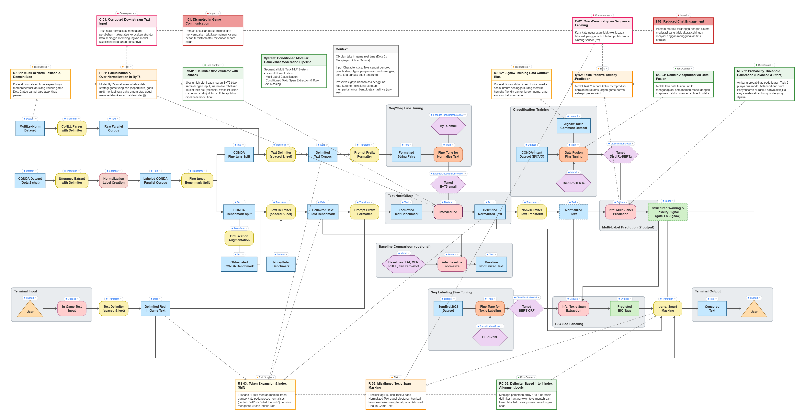

# IF5153-Chat-Moderation

In-Game Chat Moderation and Censor, IF5153 NLP kelompok 12.

Pipeline moderasi chat game: chat mentah dinormalisasi, diklasifikasi toksik atau tidak, lalu kata toksik disensor. Kata yang tidak disensor tetap dalam ejaan asli pemain.



| Task | Isi | Model | README |
| --- | --- | --- | --- |
| 1 | Lexical normalization | ByT5-small | [src/task_1](src/task_1/README.md) |
| 2 | Toxicity classification | DistilRoBERTa | [src/task_2](src/task_2/README.md) |
| 3 | Toxic span extraction dan censorship | BERT-CRF | [src/task_3](src/task_3/README.md) |
| Pipeline | Gabungan Task 1 -> 2 -> 3, demo, evaluasi | | [src/pipeline](src/pipeline/README.md) |

## Mulai

```bash
uv sync
```

1. Siapkan data: [data/README.md](data/README.md).
2. Taruh bobot model: [src/pipeline/README.md](src/pipeline/README.md#model).
3. Jalankan demo:

```bash
uv run python src/pipeline/demo.py
```

## Struktur

```
data/            raw (tidak di git), processed, annotations
docs/            rancangan BEAM (PDF, diagram, ontologi)
src/task_N/      kode tiap task
src/pipeline/    gabungan, demo, evaluasi
outputs/         hasil eksperimen tiap task dan pipeline
```
